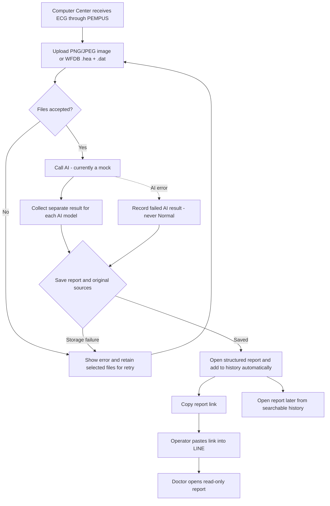

# User journey — Computer Center

Current design from the user's 28 October 2026 update. Only Computer Center staff operate the app; doctors receive a read-only report link manually through LINE.

The currently running local demo supports opening report links on the same machine only. Opening from a doctor's remote device requires deployment and access control. There is no automatic PEMPUS ingestion, LINE sending, doctor reply form or trained AI model.

Original EMS/center/doctor context is retained in [user-journey.md](user-journey.md). The former multi-role app and its flow are superseded.
