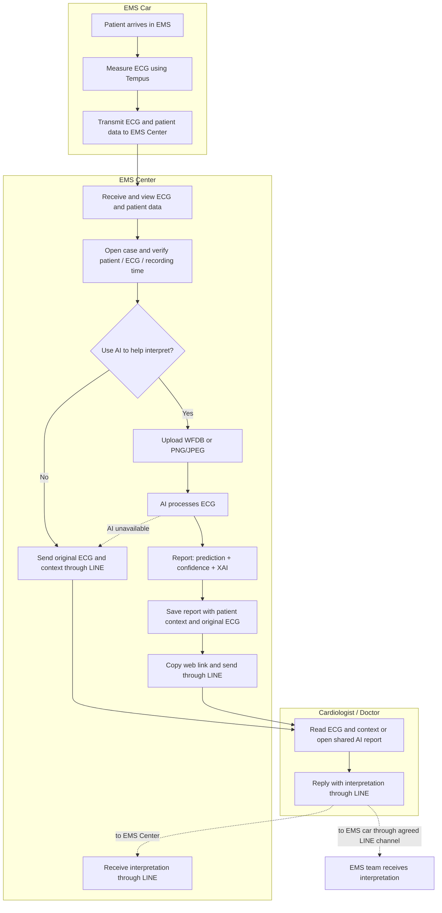

# Final journey — EMS car, EMS Center and cardiologist

Source: the final flowchart supplied by the user, with the corrected terminology **EMS Center** and **Tempus**. Tempus is the ECG device on the EMS vehicle; its exact model, viewer and integration/export mechanism are not yet verified.

## App boundary

Only EMS Center staff operate the app. The Yes branch is the current web upload → analysis → saved report/history → Copy Link flow. The No branch uses existing LINE consultation outside the app. The doctor reads the shared report and replies through LINE; there is no doctor reply form or automatic LINE sending.

Shared reports include patient/job reference, supplied notes, separate AI outputs with confidence and XAI, and original uploaded ECG sources. Confidence is a model score, not a calibrated clinical disease risk. Current AI scores and XAI are explicitly synthetic, not computed from the upload.

Old saved reports without XAI show it as unavailable. New reports include demo lead-attribution and time-region examples; these do not overlay or claim to locate findings on the original ECG.

Localhost links can only open on the same machine. External sharing requires deployment and appropriate access controls before any real patient use.
