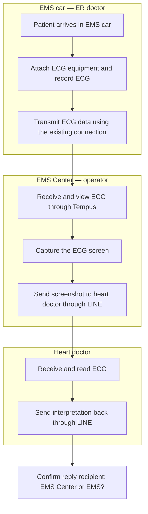
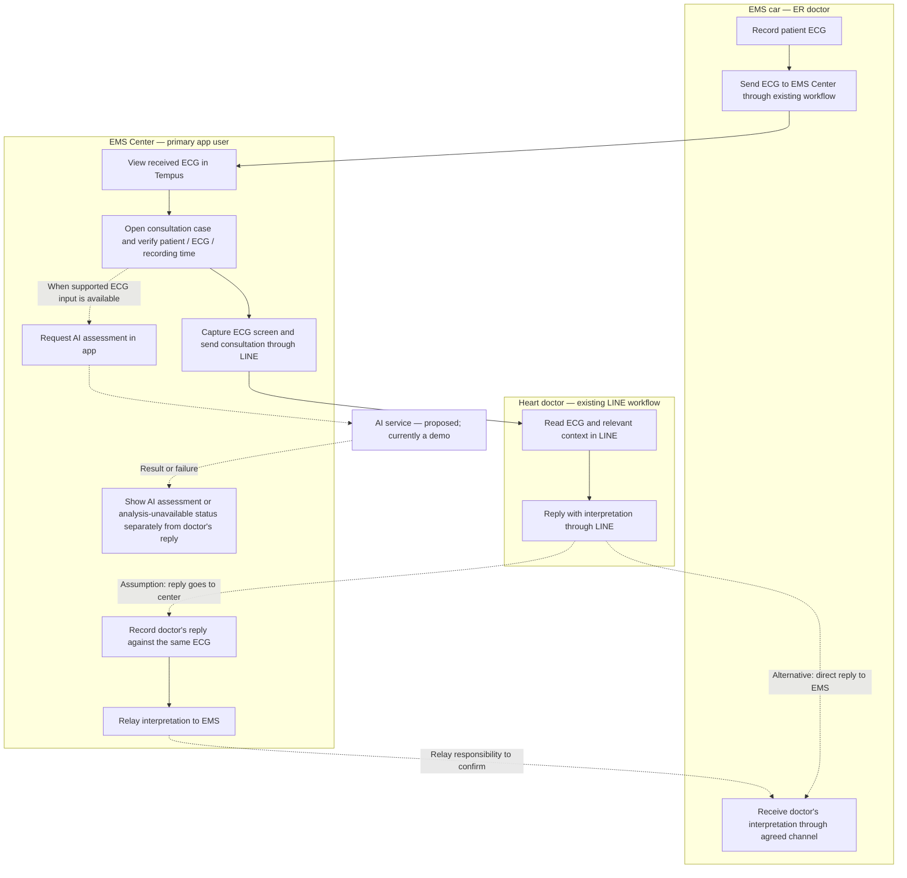

> Superseded by the user-supplied final flowchart and terminology correction. See [current final journey](flowchart.md). Tempus is the ECG device on the vehicle; the report-reply paths now follow the supplied final diagram. Earlier unconfirmed questions below are historical.

# Earlier user journey: EMS → EMS Center → heart doctor

Updated 28 October 2026 following the user's discussion with the doctor. This document is the current workflow design; the existing app still demonstrates the earlier prototype.

## Roles and confirmed workflow

| User / location | Confirmed responsibility |
| --- | --- |
| ER doctor in the EMS car | Attach ECG equipment to the patient and record ECG. The vehicle has an ECG machine and internet. |
| EMS Center operator | Receive EMS ECG data through Tempus, capture the screen and send the ECG screenshot to the heart doctor through LINE. |
| Heart doctor | Read the ECG and send the interpretation back. |

The recipient of the doctor's reply and any onward relay to EMS have **not been confirmed**. Tempus is the name provided by the user; no vendor features, API or export support are assumed.

## 1. Current journey — confirmed steps

## 2. Proposed application journey — for doctor review

Design proposal: the **EMS Center operator** is the main app user. Keep ECG acquisition in EMS and consultation through LINE. Add AI alongside the operator's work rather than moving case entry to the ambulance or requiring the heart doctor to adopt another app.

Solid arrows show the proposed main path. Dashed arrows show optional AI support or an unconfirmed return route. These are design choices, not existing integrations.

### Operator's screen sequence

| Screen | Operator's action | Next step |
| --- | --- | --- |
| Received ECG / consultation case | View ECG in Tempus, open a case in the proposed app and verify its identity/time. Initially this may require manual entry/import. | Prepare consultation. |
| Consultation | Capture the ECG screen and send through the existing LINE process. AI may run separately when a supported ECG input exists. | Track the consultation; do not wait for AI. |
| Case status and response | View AI output separately; record the doctor's reply manually if the reply comes to the center. | Relay to EMS if that responsibility is confirmed. |

The heart doctor's journey stays in LINE in this proposal. The app does not assume automated LINE sending, reply ingestion, Tempus ingestion or access to a hospital patient list.

### Exceptions to show in the prototype

- **No ECG received or wrong ECG selected:** operator follows the existing contact/retransmission process with EMS and verifies the correct record before sending. Who to contact and when to escalate must be agreed with the clinical team.
- **AI unavailable, unsupported input or analysis failure:** consultation through LINE continues; show no AI result rather than treating failure as Normal.
- **No doctor response:** show that a response has not been recorded; follow the existing escalation process. Do not invent a timeout or escalation recipient.
- **Another ECG from the same patient:** add a new ECG record with its own time, AI output and linked consultation/reply; retain previous records.

## Decisions still needed

1. Does the heart doctor reply to the EMS Center, EMS, or a shared LINE group? Who confirms EMS received the interpretation?
2. What can Tempus provide: raw waveform, export file, screenshot only, or an approved integration? A screenshot is not automatically valid input for a waveform CNN.
3. Who should see AI output and when? For an independent physician-vs-AI research comparison, keep AI output out of the doctor's consultation until their interpretation is recorded.

Until those decisions are confirmed, use manual handoffs and synthetic data in the prototype. The chart describes a proposed workflow, not a validated clinical protocol or a completed software integration.
